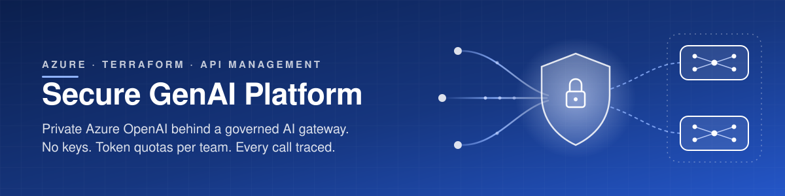
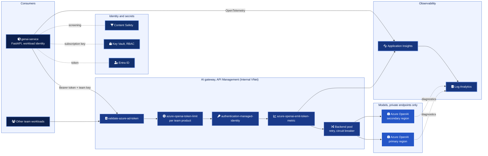
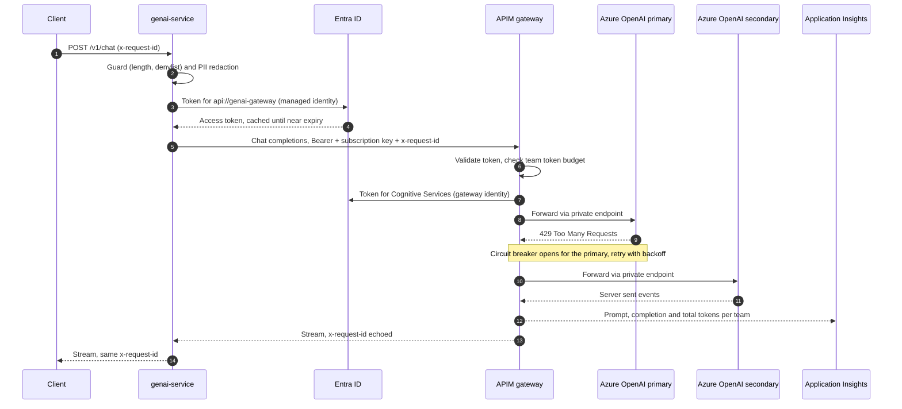
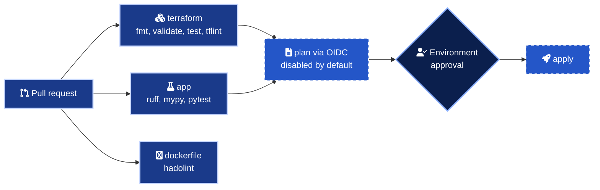

<div align="center">



# Secure GenAI Platform on Azure

Run Azure OpenAI for many teams through one private, keyless and metered gateway.

<a href="infra/terraform"></a>
<a href="apim-policies"></a>
<a href="infra/terraform/versions.tf"></a>
<a href="app"></a>
<a href="app"></a>
<a href=".github/workflows/ci.yml"></a>
<a href="LICENSE"></a>

</div>

<br>

## In numbers

| | |
| --- | --- |
| 0 | API keys in the chain. Local auth is disabled on every Cognitive Services account |
| 43 | Terraform resource blocks across 31 resource types, in 14 files |
| 18 | Validation rules guarding 14 of the 18 input variables |
| 3 | APIM policy files, loaded by Terraform as reviewed code |
| 4 | Private DNS zones, so models, secrets and the gateway resolve only inside the VNet |
| 9 | Offline `terraform test` runs with mocked providers |
| 44 | Python unit tests, 94 percent branch coverage |
| 15 | STRIDE threats mapped to a control and a file |
| 3 | Architecture decision records |

## What it is

A reference platform for putting generative AI into production inside an enterprise. Every team calls one API Management gateway, which authenticates the caller with Entra ID, enforces a token budget per team, swaps in its own managed identity and routes to Azure OpenAI deployments in two regions over private endpoints. Usage is emitted as token metrics per team, so cost can be shown back without asking anyone for a spreadsheet. A small FastAPI service shows the client side of the contract, with streaming, request tracing and input guardrails.

## Architecture



Network topology, subnets and NSGs are in [docs/architecture.md](docs/architecture.md).

## How a request flows



## Quick start

Everything below runs on a laptop without an Azure subscription.

```bash
git clone https://github.com/marlyngiselle/secure-genai-platform-azure.git
cd secure-genai-platform-azure

# Infrastructure, offline
terraform -chdir=infra/terraform init -backend=false
terraform -chdir=infra/terraform validate
terraform -chdir=infra/terraform test
tflint --chdir=infra/terraform --config="$PWD/.tflint.hcl" --init
tflint --chdir=infra/terraform --config="$PWD/.tflint.hcl"

# Sample service
python3.11 -m venv .venv
.venv/bin/pip install -e ".[dev]"
.venv/bin/ruff check . && .venv/bin/mypy && .venv/bin/pytest
```

To deploy, write your state storage account into `infra/terraform/backend.hcl` (see `backend.hcl.example`), then run from a machine with access to Azure.

```bash
az login
export TF_VAR_subscription_id="$(az account show --query id -o tsv)"
terraform -chdir=infra/terraform init -backend-config=backend.hcl
terraform -chdir=infra/terraform plan -var-file=env/dev.tfvars -out=tfplan
terraform -chdir=infra/terraform apply tfplan
```

Then point the sample service at the gateway from inside the VNet.

```bash
export GENAI_GATEWAY_BASE_URL="$(terraform -chdir=infra/terraform output -raw gateway_base_url)"
export AZURE_CLIENT_ID="$(terraform -chdir=infra/terraform output -raw workload_identity_client_id)"
.venv/bin/uvicorn --factory genai_service.main:create_app --app-dir app/src --port 8080
```

## Security model

| Control | Layer | Implementation |
| --- | --- | --- |
| No public model endpoint | Network | `public_network_access_enabled = false` and a private endpoint per account, DNS in `privatelink.openai.azure.com` |
| No keys | Identity | `local_auth_enabled = false` on Azure OpenAI and Content Safety |
| Caller authentication | Gateway | `validate-azure-ad-token` against the gateway audience, plus a product subscription key |
| Backend authentication | Gateway | `authentication-managed-identity` with a user-assigned identity |
| Least privilege | RBAC | `Cognitive Services OpenAI User` for the gateway, `Key Vault Secrets User` and `Monitoring Metrics Publisher` for the workload |
| Fair use | Gateway | `azure-openai-token-limit` per team, tokens per minute and a periodic quota |
| Resilience | Gateway | Backend pool across regions, circuit breaker on 429 and 5xx, retry with exponential backoff |
| Secrets | Key Vault | RBAC mode, private endpoint, purge protection, `prevent_destroy` |
| Input hygiene | Workload | Length and message limits, prompt injection denylist hook, PII redaction hook |
| Traceability | All | `x-request-id` from client to model and back, diagnostic settings on every resource |
| Supply chain | CI | Actions pinned to commit SHA, `persist-credentials: false`, OIDC instead of secrets |

The full STRIDE analysis is in [docs/threat-model.md](docs/threat-model.md).

## Delivery



The three validation jobs run on every pull request with no cloud access. The plan job is wired for OIDC federation and stays off until a federated credential and the repository variables exist.

## Before you deploy

> [!WARNING]
> An APIM instance injected in a VNet takes 30 to 60 minutes to create, and the Developer SKU has no SLA. Use `Premium_N` with zones for production.

> [!IMPORTANT]
> In `Internal` mode the gateway has no public DNS name. The sample service, your laptop or your CI runner must resolve `azure-api.net` through the private zone, which means running inside the VNet or through a peered network with DNS forwarding.

> [!WARNING]
> Model deployments consume regional quota of the subscription. If a region has no capacity left for a model, the apply fails with `InsufficientQuota`. Check quota per region before adding a pool member.

> [!CAUTION]
> Key Vault and Cognitive Services accounts are soft deleted. With purge protection on, a destroyed vault keeps its name for 90 days. The random suffix on globally unique names exists so a rebuild does not collide with the deleted copy.

## Repository map

| Path | What it holds |
| --- | --- |
| [`infra/terraform/`](infra/terraform) | Root module, one file per concern (network, openai, apim, keyvault, monitoring, rbac) |
| [`infra/terraform/tests/`](infra/terraform/tests) | Offline plan tests with mocked providers |
| [`infra/terraform/env/`](infra/terraform/env) | Variable files per environment |
| [`apim-policies/`](apim-policies) | Gateway policies as XML, with a step by step explanation |
| [`app/`](app) | FastAPI sample service, tests and Dockerfile |
| [`docs/`](docs) | Architecture, threat model, operating model and ADRs |
| [`.github/workflows/ci.yml`](.github/workflows/ci.yml) | Validation pipeline and the disabled OIDC plan job |

## Documentation

| Document | Answers |
| --- | --- |
| [Architecture](docs/architecture.md) | How the network, the gateway and the models fit together, and why azapi is used twice |
| [Threat model](docs/threat-model.md) | What can go wrong on the request path and which control stops it |
| [Operating model](docs/operating-model.md) | How a team is onboarded, how quotas are sized and how cost is shown back |
| [APIM policies](apim-policies/README.md) | What each policy does, in order |
| [ADR 0001](docs/adr/0001-api-management-as-ai-gateway.md) | Why API Management is the AI gateway |
| [ADR 0002](docs/adr/0002-managed-identity-no-keys.md) | Why there are no API keys anywhere |
| [ADR 0003](docs/adr/0003-token-based-quotas-per-team.md) | Why quotas are counted in tokens, per team |
| [Sample service](app/README.md) | How the client side of the contract works |

<br>

<div align="center">
<sub>Built and maintained by Giselle Da Costa. MIT licensed.</sub>
</div>
