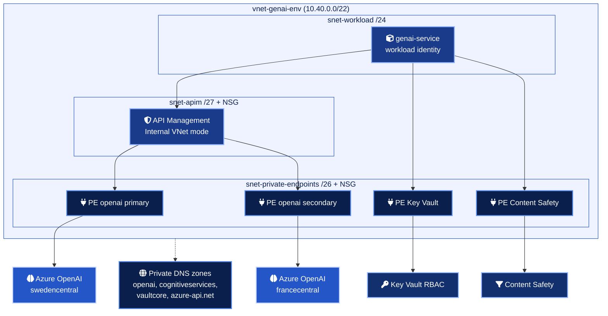

# Architecture

## Goals

| Goal | How the design meets it |
| --- | --- |
| No public path to a model | Azure OpenAI, Key Vault and Content Safety have public network access disabled and are reached through private endpoints |
| No keys | Local auth is disabled on every Cognitive Services account. Callers and the gateway use Entra ID tokens |
| One front door | Every workload calls API Management. Nothing calls Azure OpenAI directly |
| Fair sharing | Token limits and quotas per team product, enforced before the backend is touched |
| Resilience | A backend pool spreads load across regions, with a circuit breaker per member and retries in the gateway |
| Accountability | Token metrics per product and deployment, request IDs end to end, diagnostic settings on every resource |

## Network topology

The private endpoints of both Azure OpenAI accounts live in the platform VNet, even though the accounts sit in other regions. Traffic stays on the Microsoft backbone and the VNet resolves each account name to a private IP through `privatelink.openai.azure.com`.

## Components

| Component | Terraform file | Notes |
| --- | --- | --- |
| Resource group, identities | `main.tf` | Two user-assigned identities, one for the gateway, one for the workload |
| VNet, subnets, NSGs, private DNS | `network.tf` | NSG rules match the stv2 APIM requirements (3443, 6390, Storage, Sql, Key Vault, Monitor, Entra ID) |
| Azure OpenAI accounts and deployments | `openai.tf` | One account per entry in `openai_instances`, every model in `model_deployments` on each |
| API Management | `apim.tf` | Developer or Premium SKU, Internal or External VNet mode, API, operations, products, backends, pool, logger, diagnostic |
| Key Vault | `keyvault.tf` | RBAC mode, purge protection, `prevent_destroy` |
| Content Safety | `content_safety.tf` | Optional, toggled by `enable_content_safety` |
| Log Analytics, Application Insights, diagnostic settings | `monitoring.tf` | `allLogs` and `AllMetrics` from every resource to one workspace |
| Role assignments | `rbac.tf` | Least privilege data plane roles only |

## Why azapi in two places

`azurerm` 4.x covers almost everything. Two gaps remain, and `azapi` fills them with schema validated bodies.

| Resource | Gap in azurerm |
| --- | --- |
| `Microsoft.ApiManagement/service/backends` of type `Pool` | No pool backend type |
| `Microsoft.ApiManagement/service/diagnostics` | No `metrics` switch, which `azure-openai-emit-token-metric` requires |

## Choosing the APIM SKU

| Setting | Developer_1 | Premium_N |
| --- | --- | --- |
| SLA | None | 99.95 percent, 99.99 with zones |
| VNet injection | Yes | Yes |
| Scale units | 1 | N, plus additional regions |
| Use | dev and test | production |

The v2 tiers (Standard v2, Premium v2) use VNet integration rather than injection and are a valid alternative. This stack targets the classic tiers because Internal mode keeps the gateway with no public endpoint at all.
